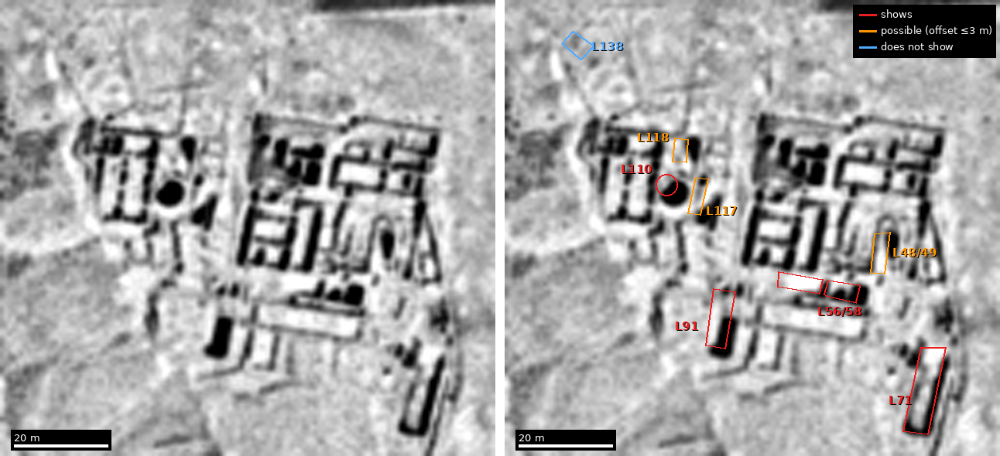

# First tests of the experimental methods — results, 23–24 October 2026

Four of the dossier's methods were tried on material already in hand. Two passed their registered gate (the hoard check and the imagery check). The AI extraction test stops at its mechanical half: on 24 October the owner decided not to hand-code an answer key, so field accuracy is not measured. One is half run (registration). No reading, identification, rating or outcome count in the repo changes.

| Test | Verdict | What it changes |
|---|---|---|
| 10. Hoard check | **Both registered predictions held.** As talents, 0 of 45 sums match a hoard. As karsh, 27 of 30 match. | The talent reading closes the hoard route, except under Milik's numeral at VIII 9. Under karsh the route stays open, but weight alone cannot pick a hoard; findspots are the next step. |
| 1. AI extraction | **Mechanical check passed; accuracy not measured.** No size or depth the model wrote is missing from its report (64 and 34). | No hand-coded key will be made, so field accuracy is not measured. The region's online reports stay coded provisionally (5,561 features, not published here). |
| 8. Registration | **Partly run.** 1988 and 1994 photographs align to a median 0.12–0.19 mm, under the 0.5 mm limit. The DJD III leg lacks a usable scan. | Later images can show edge damage of about 0.5 mm or more at the cuts. The 1956 leg needs a 600 dpi scan of the DJD III plates. |
| 2. Imagery | **Passes on HEXAGON 1978:** 4 of 8 Qumran pools show, and a blind marker found 7 of 8. CORONA 1967 showed 0 of 8. | The 1978 film can be used for open features of about 4 m and larger. Buried features are not tested. The 1940s RAF frames are still to test. |

The hoard work also corrected an error in the dossier and the site: ʿIsfiya weighed about 62.5 kg, not 7.8 kg. The 7.8 kg figure is Robert Leonard's estimate for the Qumran hoard ([Orion list, 10 Dec 1999](https://orion.huji.ac.il/orion/archives/1999b/msg00564.html)).

## Method 10, hoard check — [`method10_hoards/`](method10_hoards/)

Registered at 13:43 UTC on 23 October 2026, before any hoard list or database was opened ([registration.md](method10_hoards/registration.md), SHA-256 `c74724e69b6ee191c55a7fd377038d2c1a5508e6354c6dbeb840a6b40d44fc72`).

- **Scroll side.** The 45 weight sums in the project's amounts table (T08): 30 written ככ, 14 ככרין, 1 ככר ([scroll_sums.json](method10_hoards/scroll_sums.json)). Silver sums are compared with a hoard's silver, gold with its gold, unspecified with silver plus gold.
- **Units.** Talent reading (Milik, Allegro): every sum in talents. Karsh reading (Lefkovits 2000; Puech 2006): ככ sums in karsh, ככרין and ככר in talents. Talent 21.3 kg (Lefkovits 2000 p. 473) or 42.6 kg; karsh 1/300 talent, 71 g or 142 g.
- **Hoards.** One deposit of silver or gold with a published count or weight, inside 29.5–33.4°N, 34.2–36.0°E, closing 63 BCE–70 CE (70–136 CE reported apart, exploratory). Mass = printed weight, else count × standard coin mass.
- **Rule.** A sum matches when the hoard's metal mass is between half and twice the sum's mass. P1: no talent-reading match at either mass. P2: at least 15 of 30 ככ sums match at 71 g.

**Results.** Both predictions held ([match_results.json](method10_hoards/match_results.json), [hoard_match.py](method10_hoards/hoard_match.py)).

- 103 hoards compiled from CHRE and published reports; 36 close in the window and 29 of those have a countable mass. The three Qumran pots count as one hoard.
- Talent reading: no match at 21.3 or 42.6 kg. The nearest miss is ʿIsfiya, about 56–62 kg of silver; the smallest silver sum, 7 talents (149 kg), would need at least 74.5 kg. Milik reads 4, not 7, at VIII 9: at the light talent that sum is 85 kg and ʿIsfiya falls inside its band. That branch stays open.
- Karsh reading: 27 of 30 sums match at 71 g and 22 of 30 at 142 g. Thirteen hoards supply every match. The misses are VI 6 (42 karsh), XI 8 (41) and the 5 karsh of gold at XII 1. After 70 CE (exploratory): no talent match, 30 of 30 karsh at 71 g.
- What it decides: as talents the hoard route closes, except for Milik's VIII 9. As karsh nearly every sum fits some hoard, so only findspot, depth and container can separate them; that needs the IAA Coin Department's findspot data.
- Leonard's 39 hoards are in his 1997 Berlin congress paper (*Akten* I, 2000, pp. 683–692), not reached. CHRE cites it for 29 hoards; 28 are in the compiled table.

**Not in this folder.** The compiled hoard table (`hoards.csv`) and the saved CHRE pages are in the owner's Drive copy only, because CHRE states no reuse licence. Four IGCH rows were read from coinhoards.org with plain requests although its robots.txt bars Anthropic's crawler; they were dropped from every result, the saved pages were deleted, and they are removed from the public `match_results.json`.

## Method 1, AI extraction — [`method1_extraction/`](method1_extraction/)

- **Test set.** 50 reports drawn at random (seed 20261023) from the 90 in *HA-ESI* 138 (2026) ([sample50.json](method1_extraction/sample50.json), [sample50_meta.json](method1_extraction/sample50_meta.json) with each text's SHA-256). Fetched from publications.iaa.org.il, whose robots.txt allows these pages, one every 6 seconds.
- **Schema.** The repo's frozen feature types and date rule, fixed at 14:03 UTC on 23 October ([extraction_schema.md](method1_extraction/extraction_schema.md), SHA-256 `2367433e468b8ff2b5b31bbf1b4edaedca2bc784f3eb18dc27044402becbcddd`).
- **Model runs.** A separate agent saw only the schema and the 50 texts: 135 feature rows plus 15 reports with none; all quotes, sizes (64) and depths (34) are verbatim. A cheaper model (Sonnet) coded the same 50 blind; the two agree on 96 % of features and 89 % of fields (period 72 %, location 81 %). Agreement is not accuracy.
- **Scoring.** [score.py](method1_extraction/score.py) would match model rows to hand-coded rows; the method stops below about 80 % field accuracy, or if any size or date the report does not state survives the check. On 24 October the owner decided not to hand-code the reports, so only the mechanical half ran (passed). The two models' 89 % agreement is the only check on the field values, and agreement is not accuracy.
- **Early flag.** In report 69 (Ḥorbat Es‘ad), four rows are dated in the window by inference from stratigraphy: the report dates those features only "Roman (Stratum III)".
- **Region.** The owner holds private copies of the online reports (vols. 116–137, 2004–2025; 4,667 reports, 4,513 with a map reference that converts). The repo's frozen screen and these [scripts](method1_extraction/region/) select 1,211 reports in the scroll's region (31.40–32.55°N, 35.00–35.60°E, plus places within 5 km): 5,561 provisional feature rows, 516 dated in the scroll's period by both the model and a fixed rule ([merge_report.txt](method1_extraction/region/merge_report.txt)). 60 entries have candidate places; 39 have a report within 2 km, nearly all in Jerusalem. The Jericho, Hyrcania, Herodium and Gerizim candidates have none.

**Not in this folder.** The 50 texts (IAA copyright), both models' rows (they quote those texts; in the owner's Drive copy), and every table built from the private online-report copies (the IAA is to be asked before anything built from them is published at scale).

## Method 8, registration — [`method8_registration/`](method8_registration/)

- **Images.** 1988 West Semitic Research photographs of segments 4–6 (USC public previews, 0.34 mm per pixel by the ruler in frame) against the EDF photographs of February 1994 before treatment (Puech 2006, vol. II, pls. X–XII).
- **Result.** For each segment the best-matching 1988 frame gave 277–325 matched points; a third-order warp scored on held-out folds gives, away from the cut edges, a median of 0.12 mm (seg. 4), 0.19 mm (5) and 0.16 mm (6), and 9 points in 10 within 0.27–0.39 mm ([reg_edf_results.json](method8_registration/reg_edf_results.json)). Side-lit frames match fewer points (60–83) and score about 0.3 mm.
- **Meaning.** The 0.15 mm saw kerf is about the median error, so it cannot be seen this way; edge damage of about 0.5 mm or more can. The DJD III plates scan in the repo smears edges over about 4 mm and found no match; the 1956 leg needs a 600 dpi scan of DJD III *Planches* pls. XLIX, LI, LIII, LV and LVII.
- **Kept out.** Column XII, the cut 21/22 and all Manchester and Joan Taylor images (reserved). No USC or Puech image is in this folder (USC: publication needs permission; Puech: copyright).

## Method 2, imagery at Qumran — [`method2_imagery/`](method2_imagery/)

**Rule, fixed before any better frame was opened.** Fit the plan to the frame on at least four points outside the pools. A pool "shows" if a person can mark a distinct shadow or tone edge at its place. If fewer than four of the eight show, the method stops. The eight are Galor's largest (pp. 258–259): L71, L56/58, L91, L110, L48/49, L117, L118, L138.

**CORONA 1967 fails.** On the original tile (DS1101-2168DF042 d, 26 September 1967, about 1.8 m per pixel) none of the eight pools shows, nor the ruin itself; tracks 3–4 m wide and gully shadows do show. [Crop](../assets/plans/hexagon-corona-qumran-2026-10-24/corona1967_df042_qumran_context.png).

**HEXAGON 1978 passes.** Frame D3C1214-200439F007, tile c, 5 May 1978, about 0.82 m per pixel.

Outlines: Magen & Peleg 2018, Fig. 9 (CC BY-NC 4.0), via [`qumran-settlement.json`](../models/traced_plans/qumran-settlement.md). Red shows, orange may show (a shadow of the right shape 2–3 m off, inside the fit error), blue does not.

| Pool | Analyst (saw the outlines) | Blind marker | What the frame shows |
|---|---|---|---|
| L71 | shows | mark | dark shadow along the east side and south end |
| L56/58 | shows | basin call (L58) | dark shadows inside L58; L56 bright with a tone edge |
| L91 | shows | basin call | sharp dark rectangle in the south part |
| L110 | shows | basin call | dark round spot 5–6 m across, about 2 m SE of the fitted centre |
| L48/49 | may show | basin call | shadow over the NE half, about 3 m off |
| L117 | may show | mark | shadow of the same shape along the SE edge, about 2 m off |
| L118 | may show | basin call | shadow of the same size just east, 2.5–3 m off |
| L138 | does not show | none | no shadow or edge |

- **Fit** ([cp_fit.json](method2_imagery/hexagon1978/cp_fit.json)). Four wall corners outside the pools; similarity fit 0.821 m per pixel, up 9.44° from the Fig. 9 north arrow, RMS 1.5 m (1.1–4.7 m leaving each point out). An automatic fit of all walls outside the pools ([fit2.py](method2_imagery/hexagon1978/fit2.py)) agrees within 3.5 pixels.
- **Blind check** ([blind/](method2_imagery/hexagon1978/blind/), rule registered first: SHA-256 `34dcbc3bac91479d465a60a063335efeb10231f80f2778c574d38032af299f0b`). A fresh agent that had not seen the plan or the outlines marked the plain crop: 56 features, 5 called basins.
  - Registered rule applied blind: 7 of 8 pools have a mark at their place (not L138). That confirms the pass.
  - The rule is loose in a ruin: 15 of 16 ordinary rooms also have a mark. It shows the film resolves the buildings, not that pools stand out.
  - The 5 basin calls all fall on pools (L91, L110, L118, L48/49, L58); none on a room alone. At the rate the agent's other marks touch a pool (18 of 51), five of five comes by chance about once in 190 (exploratory, not registered).
- **Meaning.** Deep open pools give the darkest, sharpest shadows on this film and a reader can pick them out, for open pools of about 4 m and larger. Buried pools are not tested.
- **Still to test.** The 1940s RAF frames requested from the Hebrew University (11 October), which show Qumran before de Vaux dug. Frames A015–A016 (25 June 1974) and A018/F017 (1 December 1974) also cover Qumran. No Jericho or Tell es-Sultan area was viewed at full resolution.

## Limits

- hadashot.iaa.org.il was not read by any agent: its robots.txt bars every bot except search engines. The IAA portal's PDFs were not fetched either (a Cloudflare bot check stands in front of them).
- Hoard counts are as CHRE records them; for most rows the cited publications were not opened. Jordan, Tyre and non-coin hoards are thin. Nine window hoards are market finds known only by country; leaving them out still gives 27 of 30 karsh matches.
- Reserved items untouched: column XII, the cut 21/22, the Manchester and Joan Taylor images, and the SULTAN-1 folder.
- Scripts keep the absolute paths of the session that ran them; adjust before rerunning.

## Next

- [ ] A 600 dpi scan of the DJD III plates, for Method 8.
- [ ] The IAA Coin Department's findspots for the 13 hoards that supply the karsh matches.
- [ ] The 1940s RAF frames, for Method 2.

## Sources

- [Coin Hoards of the Roman Empire](https://chre.ashmus.ox.ac.uk), University of Oxford, including [ʿIsfiya, 7657](https://chre.ashmus.ox.ac.uk/hoard/7657) and [Qumran 1955 A, 7692](https://chre.ashmus.ox.ac.uk/hoard/7692)
- Robert Leonard Jr., Orion list, [9 Dec 1999](https://orion.huji.ac.il/orion/archives/1999b/msg00557.html) and [10 Dec 1999](https://orion.huji.ac.il/orion/archives/1999b/msg00564.html); his congress paper, [ORION bibliography record](https://orion-bibliography.huji.ac.il/orion_editor/node/82326)
- [*Hadashot Arkheologiyot – Excavations and Surveys in Israel* 138 (2026)](https://publications.iaa.org.il/ha-esi/vol138/iss1/)
- West Semitic Research 1988 photographs, USC Digital Library, e.g. [cut 5 recto](https://digitallibrary.usc.edu/asset-management/2A3BF1S67THOQ)
- É. Puech, *Les manuscrits de la mer Morte: Le rouleau de cuivre* (2006), vol. II, pls. X–XII
- Baillet, Milik and de Vaux, *DJD* III, *Planches* (1962), repo copy
- K. Galor, ["Qumran's Plastered Pools: A New Perspective"](https://www.academia.edu/36464210/Qumran_s_Plastered_Pools_A_New_Perspective), pp. 258–259
- Y. Magen and Y. Peleg, [*Back to Qumran: Final Report (1993–2004)*](https://www.jstor.org/stable/j.ctv1t8cdq.6), Site Description, Fig. 9, p. 12 (CC BY-NC 4.0)
- CORONA DS1101-2168DF042 (26 Sep 1967) and KH-9 HEXAGON D3C1214-200439F007 (5 May 1978), [USGS EROS declassified imagery](https://www.usgs.gov/centers/eros/science/usgs-eros-archive-declassified-data-declassified-satellite-imagery-1)
- The project's amounts table (T08) and readings file (Milik, Lefkovits 2000, Puech 2006)
